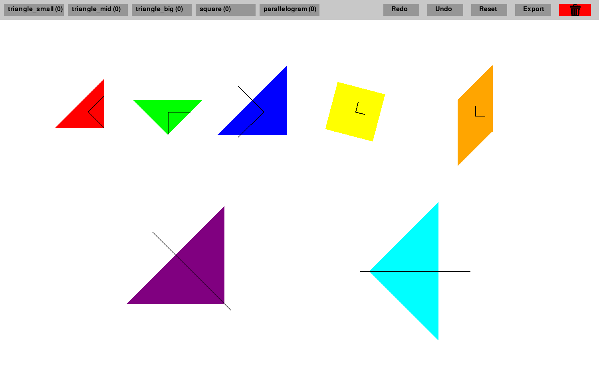

<p align="center">
  
</p>

<h1 align="center">UR Tangram Control</h1>

<p align="center">
  <strong>EN:</strong> Arrange a tangram on screen, then send its seven target poses to a UR5e for pick-and-place.<br>
  <strong>FR :</strong> Composer un tangram à l’écran, puis transmettre ses sept poses au robot UR5e pour une opération de prise et de dépôt.
</p>

<p align="center">
  <a href="https://github.com/mlmdc">← Back to profile / Retour au profil</a>
  &nbsp;·&nbsp;
  <a href="#contents">Contents / Sommaire</a>
</p>

<a id="contents"></a>

## Contents / Sommaire

- [Overview / Présentation](#overview)
- [Problem and approach / Problématique et approche](#problem-and-approach)
- [Technical decisions / Choix techniques](#technical-decisions)
- [Results and learnings / Résultats et apprentissages](#results-and-learnings)
- [Getting started](#getting-started)
- [Project files / Fichiers du projet](#project-files)
- [Contributors / Contributeurs](#contributors)
- [Credits / Crédits](#credits)

<a id="overview"></a>

## Overview / Présentation

**EN.** This project connects a desktop tangram editor to a Universal Robots UR5e. It was developed for the Robot Control course at the University of Ljubljana and demonstrates a path from a user-defined 2D layout to a physical pick-and-place sequence. The Python application lets an operator arrange the pieces; the robot program receives their poses and performs the corresponding moves.

**FR.** Ce projet relie un éditeur de tangram sur ordinateur à un robot Universal Robots UR5e. Développé dans le cadre du cours de commande des robots de l’Université de Ljubljana, il illustre le passage d’une disposition 2D définie par l’utilisateur à une séquence physique de prise et de dépôt. L’application Python permet de placer les pièces ; le programme robot reçoit leurs poses et exécute les mouvements correspondants.



*EN: Example editor view; the pieces are arranged for illustration and no robot is connected.*<br>
*FR : Aperçu de l’éditeur ; les pièces sont disposées à titre d’exemple et aucun robot n’est connecté.*

### Python application

**EN.** The Pygame interface displays the seven tangram pieces. The operator can add, drag, snap, rotate, undo, redo, reset or remove pieces, then export the layout as robot poses.

**FR.** L’interface Pygame affiche les sept pièces du tangram. L’opérateur peut les ajouter, déplacer, aligner, tourner, annuler ou rétablir une action, réinitialiser la disposition ou supprimer une pièce, puis exporter la disposition sous forme de poses robot.

### Universal Robots program

**EN.** The PolyScope project in `RobotControl/tangram.urp` connects to the Python host, receives the seven six-value poses, and runs the pick-and-place sequence using the configured UR5e and gripper.

**FR.** Le projet PolyScope `RobotControl/tangram.urp` se connecte à l’ordinateur, reçoit les sept poses à six valeurs et exécute la séquence de prise et de dépôt avec l’UR5e et le préhenseur configuré.

### How the two parts work together / Lien entre les deux parties

**EN.** Python runs a TCP server on port `8888`; the robot program is the client. The exported layout is converted from screen coordinates to robot-frame positions and orientations, then sent over the socket. Python handles the UI and data transfer; PolyScope controls robot motion and the gripper.

**FR.** Python ouvre un serveur TCP sur le port `8888` ; le programme du robot en est le client. La disposition est convertie des coordonnées écran en positions et orientations dans le repère du robot, puis transmise par socket. Python gère l’interface et le transfert des données ; PolyScope pilote les mouvements et le préhenseur.

<a id="problem-and-approach"></a>

## Problem and approach / Problématique et approche

**EN.** A robot pick-and-place task needs target positions and orientations in the robot's coordinate frame, while an operator naturally plans the arrangement visually. Manually converting each screen position into a robot pose is repetitive and makes it harder to revise the plan consistently. This project addresses that gap with a graphical editor linked directly to the robot program.

**FR.** Une opération robotisée de prise et de dépôt nécessite des positions et des orientations dans le repère du robot, alors que l’opérateur conçoit plus naturellement la disposition à l’écran. Convertir manuellement chaque position graphique en pose robot est répétitif et complique les ajustements cohérents du plan. Le projet répond à ce besoin avec un éditeur graphique relié directement au programme du robot.

**EN.** The operator builds a layout from the seven-piece tangram inventory, moving pieces on a 2D board. Snapping helps align vertices; keyboard rotation changes orientation in 15-degree steps, and undo, redo, reset and removal support iteration. On export, the Python application maps screen coordinates to the configured robot work area and converts each piece's position and angle to a six-value pose. It sends seven pose slots over TCP. The PolyScope program receives those targets and sequences the corresponding picks and placements.

**FR.** L’opérateur compose la disposition à partir des sept pièces du tangram et les déplace sur un plateau 2D. L’alignement magnétique aide à rapprocher les sommets ; la rotation au clavier s’effectue par incréments de 15 degrés. Les fonctions annuler, rétablir, réinitialiser et supprimer facilitent les ajustements. À l’export, l’application Python convertit les coordonnées écran vers la zone de travail configurée du robot et transforme la position et l’angle de chaque pièce en une pose à six valeurs. Elle transmet sept emplacements de pose par TCP. Le programme PolyScope reçoit les cibles et enchaîne les prises et dépôts correspondants.

**EN.** This separation keeps interaction and layout editing on the PC, while motion execution remains on the UR controller. The workflow depends on the PC and robot being reachable on the same configured network, and on the coordinate mapping, offsets, gripper and robot workspace being calibrated for the physical installation. The interface prepares targets; it does not replace robot safety checks or validate that a layout is collision-free.

**FR.** Cette séparation conserve l’interaction et l’édition de la disposition sur PC, tandis que l’exécution des mouvements reste sur le contrôleur UR. Le flux suppose que le PC et le robot soient joignables sur le réseau configuré, et que la conversion des coordonnées, les décalages, le préhenseur et la zone de travail soient calibrés pour l’installation physique. L’interface prépare les cibles ; elle ne remplace pas les contrôles de sécurité du robot et ne vérifie pas l’absence de collisions dans la disposition.

<a id="technical-decisions"></a>

## Technical decisions / Choix techniques

**EN.** Pygame provides a lightweight 2D editor; Python’s standard `socket`, `threading` and `queue` modules handle TCP communication without an additional networking dependency. Separate send and receive loops keep socket operations outside the main UI loop. The robot-side sequence is authored for PolyScope and uses its motion and gripper commands. This simple client/server design suits a local lab setup, but currently relies on fixed network and calibration values rather than a deployment configuration.

**FR.** Pygame fournit un éditeur 2D léger ; les modules standard Python `socket`, `threading` et `queue` assurent la communication TCP sans dépendance réseau supplémentaire. Des boucles d’envoi et de réception séparées isolent les opérations socket de la boucle d’interface. La séquence côté robot est écrite pour PolyScope et utilise ses commandes de mouvement et de préhenseur. Cette architecture client/serveur convient à un banc local, mais repose encore sur des paramètres réseau et de calibration fixes plutôt que sur une configuration de déploiement.

<a id="results-and-learnings"></a>

## Results and learnings / Résultats et apprentissages

**EN.** The project brings together a usable tangram editor and a UR5e pick-and-place program: an operator can arrange pieces on screen and send their target poses to the robot over TCP. It demonstrates the full hand-off from a visual layout to robot motion. Physical accuracy measurements and automated end-to-end tests are not included.

**FR.** Le projet réunit un éditeur de tangram utilisable et un programme de prise et de dépôt pour UR5e : l’opérateur compose une disposition à l’écran et transmet les poses cibles au robot par TCP. Il met en œuvre toute la chaîne, de la disposition visuelle au mouvement du robot. Aucune mesure de précision physique ni aucun test automatisé de bout en bout n’est fourni.

## Getting started

### Requirements

- Python 3
- A Universal Robots UR5e running the matching PolyScope program
- A configured gripper and a calibrated, safe robot work area for physical operation
- A network connection between the PC and robot that permits TCP traffic on port `8888`

The Python dependencies used by the application are Pygame and NumPy. From the repository root:

```powershell
python -m venv .venv
.\.venv\Scripts\Activate.ps1
python -m pip install pygame numpy
```

### Network configuration

1. Assign a reachable IP address to the PC and allow inbound TCP traffic on port `8888`.
2. In `src\cfg.py`, set `ip_address` to the PC address and keep `trgt_port` aligned with the robot program.
3. In the PolyScope program, set the host address used by `socket_open(...)` to the PC address. The repository includes the program project at `RobotControl\tangram.urp`.
4. Make sure the configured robot workspace and pose offsets match the physical cell. Do not run the program until the robot path and gripper setup have been checked for the installation.

The current Python server waits up to 10 seconds for the robot connection during startup. Start the robot program while the Python application is opening its connection.

On Linux, inspect the network interfaces and, if needed, assign an address on the lab network:

```bash
hostname -I
ip addr show
sudo ip addr add 192.168.65.XXX/24 dev __device_name__
```

Replace the example address and interface with values appropriate for the network.

### Run the application

From the repository root, start the Python interface:

```powershell
python src\main.py
```

Start the matching PolyScope program during the Python connection window. In the interface, add pieces from the shape buttons, drag them into position, rotate a selected piece with the left or right arrow key in 15-degree increments, and use **Export** to send the layout. **Undo**, **Redo**, **Reset** and the trash area edit the layout. Close the application and stop the robot program before restarting either side.

<a id="project-files"></a>

## Project files / Fichiers du projet

| Path | Purpose |
| --- | --- |
| `src\` | Python application, Pygame interface, coordinate conversion and TCP communication |
| `src\medias\` | Interface assets |
| `RobotControl\tangram.urp` | Main Universal Robots PolyScope project |
| `RobotControl\` | Robot programs, generated script exports and installation files, including `comm.installation` (identified in the original setup notes as the likely installation) and `tangram_inst.installation` |
| `tangram_layout.json` | Tangram layout data |

<a id="contributors"></a>

## Contributors / Contributeurs

- Mael Madec
- [Riccardo Simion](https://github.com/simionRiccard0/)

<a id="credits"></a>

## Credits / Crédits

**EN.** The TCP communication examples and initial code base were provided by Sebastjan Šlajpah ([sebastjan.slajpah@fe.uni-lj.si](mailto:sebastjan.slajpah@fe.uni-lj.si)): [sslajpah/ur_tcpip](https://github.com/sslajpah/ur_tcpip).

**FR.** Les exemples de communication TCP et la base initiale du code ont été fournis par Sebastjan Šlajpah ([sebastjan.slajpah@fe.uni-lj.si](mailto:sebastjan.slajpah@fe.uni-lj.si)) : [sslajpah/ur_tcpip](https://github.com/sslajpah/ur_tcpip).
