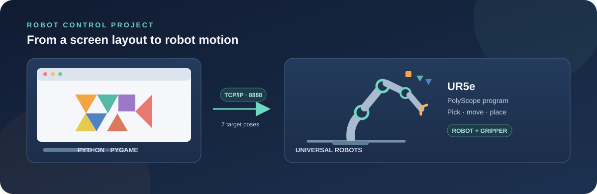
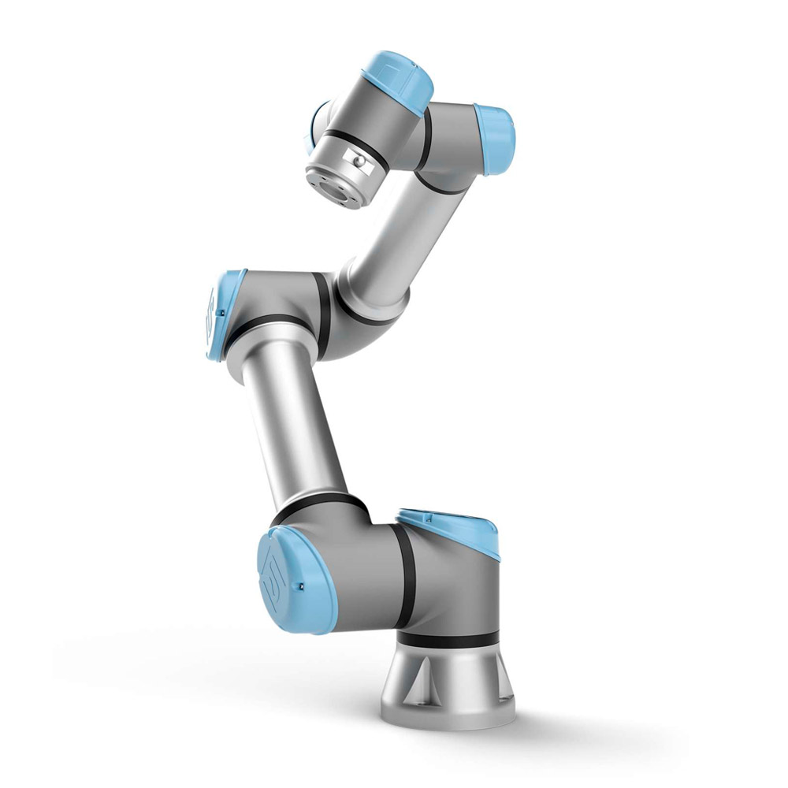
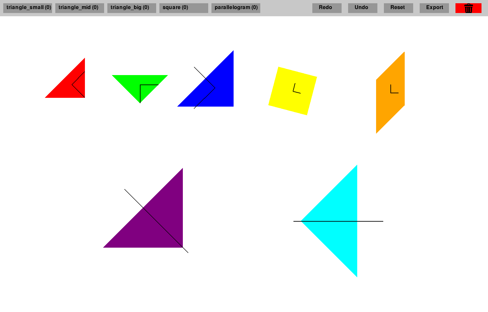
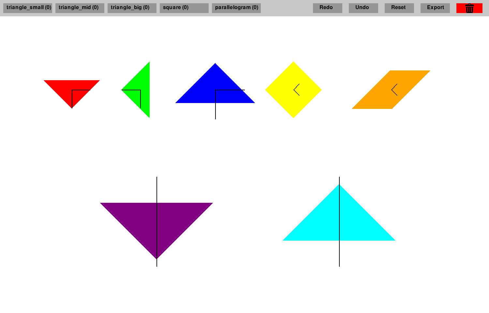
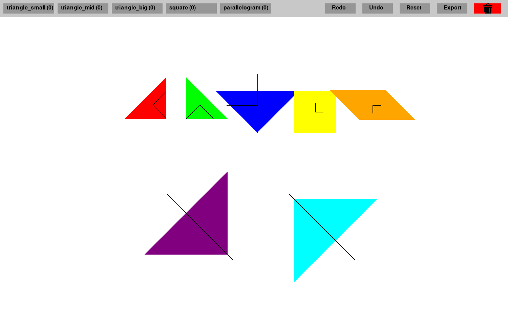
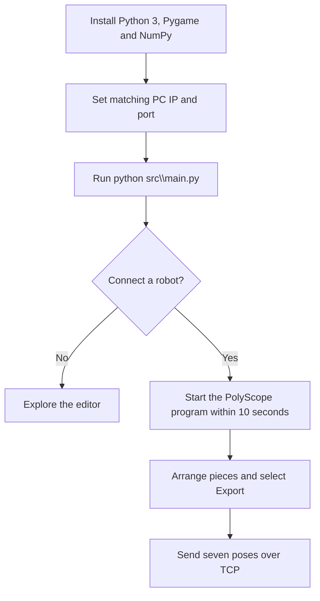

<p align="center">
  
</p>

<h1 align="center">UR Tangram Control</h1>

<p align="center">
  <strong>EN:</strong> From a 2D tangram layout to robot-frame poses for a Universal Robots UR5e.<br>
  <strong>FR :</strong> D’une disposition 2D de tangram à des poses robot pour un Universal Robots UR5e.
</p>

<p align="center">
  <a href="https://github.com/mlmdc">← Back to profile / Retour au profil</a>
  &nbsp;·&nbsp;
  <a href="#contents">Contents / Sommaire</a>
</p>

<a id="contents"></a>

## Contents / Sommaire

- [Overview / Présentation](#overview)
- [Problem and approach / Problématique et approche](#problem-and-approach)
- [Methods and features / Méthodes et fonctionnalités](#methods-and-features)
- [Technical decisions / Choix techniques](#technical-decisions)
- [Results and limitations / Résultats et limites](#results-and-limitations)
- [Getting Started](#getting-started)
- [Project files / Fichiers du projet](#project-files)
- [Contributors / Contributeurs](#contributors)
- [Credits / Crédits](#credits)

<a id="overview"></a>

## Overview / Présentation



**🇬🇧 EN** - Developed for the Robot Control course at the University of Ljubljana, this project links a desktop tangram editor with a Universal Robots UR5e.

An operator arranges seven tangram pieces on a 2D board. The Python application converts their positions and rotations into robot-frame poses and sends them over TCP to a PolyScope pick-and-place program. **The project demonstrates this workflow; it is not a general-purpose motion planner.**

**🇫🇷 FR** - Développé dans le cadre du cours de commande des robots de l’Université de Ljubljana, ce projet relie un éditeur de tangram à un Universal Robots UR5e.

Un opérateur dispose sept pièces de tangram sur un plateau 2D. L’application Python convertit leurs positions et rotations en poses dans le repère du robot, puis les transmet par TCP à un programme PolyScope de prise et de dépôt. **Le projet illustre ce flux ; ce n’est pas un planificateur de mouvement généraliste.**


**🇬🇧 EN** - The following layouts were also arranged in the editor. They illustrate different positions and rotations.

**🇫🇷 FR** - Les dispositions suivantes ont également été composées dans l’éditeur. Elles illustrent différentes positions et rotations.

| Balanced layout / Disposition équilibrée | Rotated pieces / Pièces tournées | Grouped layout / Disposition regroupée |
| --- | --- | --- |
|  |  |  |

<a id="problem-and-approach"></a>

## Problem and approach / Problématique et approche

**🇬🇧 EN** - The editor works in screen coordinates; the robot needs positions and orientations in its own frame. The application bridges the two:

1. It records each piece’s type, 2D center and angle.
2. It maps the center to the configured work area and builds a six-value pose (position plus rotation vector).
3. It sends the poses over TCP to the PolyScope client on port `8888`.

The work-area mapping and offsets are installation settings-not values measured from a camera or the table. **The editor prepares targets; it does not check reachability or plan collision-free paths.**

<br>

**🇫🇷 FR** - L’éditeur utilise des coordonnées écran, tandis que le robot attend des positions et orientations dans son propre repère. L’application assure la conversion :

1. Elle enregistre le type, le centre 2D et l’angle de chaque pièce.
2. Elle convertit le centre selon la zone de travail configurée et forme une pose à six valeurs (position et vecteur de rotation).
3. Elle transmet les poses par TCP au client PolyScope, sur le port `8888`.

La correspondance avec la zone de travail et les décalages sont des paramètres d’installation : ils ne sont pas mesurés par caméra ou à partir de la table. **L’éditeur prépare les cibles ; il ne vérifie ni leur accessibilité ni l’absence de collision des trajectoires.**

<a id="methods-and-features"></a>

## Methods and features / Méthodes et fonctionnalités

### **🇬🇧 EN** - Editor interactions

The inventory consists of two small triangles, one medium triangle, two large triangles, one square and one parallelogram. The interface supports adding pieces from a menu, dragging them, rotating them in 15-degree increments, snapping nearby vertices, and using trash, undo, redo and reset controls.

Snapping uses pixel distance and does **not** validate a tangram solution.

### Pose export

`src/main.py` exports seven poses in a fixed order: medium triangle, two small triangles, two large triangles, square and parallelogram. It maps screen coordinates to the configured robot area, applies piece-specific angle adjustments and sends the poses to PolyScope.

Export always includes seven slots. An unplaced piece retains the default pose from `src/cfg.py`; the robot program still executes all seven cycles. As a result, an incomplete layout can cause motion toward default targets.

<br>

### **🇫🇷 FR** - Interactions de l’éditeur

L’inventaire comprend deux petits triangles, un triangle moyen, deux grands triangles, un carré et un parallélogramme. L’interface permet d’ajouter les pièces depuis un menu, de les déplacer et de les tourner par incréments de 15 degrés. Elle comprend également l’alignement de sommets proches, une corbeille et des commandes pour annuler, rétablir ou réinitialiser.

L’alignement repose sur la distance en pixels et **ne valide pas** une solution de tangram.

### Export des poses

`src/main.py` exporte sept poses dans un ordre fixe : triangle moyen, deux petits triangles, deux grands triangles, carré et parallélogramme. Le programme convertit les coordonnées écran selon la zone robot configurée, applique des corrections d’angle par type de pièce et transmet les poses à PolyScope.

L’export contient toujours sept emplacements. Une pièce non placée conserve la pose par défaut de `src/cfg.py` ; le programme robot exécute malgré tout les sept cycles. Une disposition incomplète peut donc entraîner un mouvement vers des cibles par défaut.

<a id="technical-decisions"></a>

## Technical decisions / Choix techniques

### **🇬🇧 EN** - Stack and responsibilities

Pygame provides the editor, NumPy handles numeric operations, and Python’s `socket`, `threading` and `queue` modules support communication. Python maps and sends targets; PolyScope controls robot motion and the gripper.

### Coordinate mapping

Screen pixels are scaled to the configured work-area bounds, offset to that area and converted from millimetres to metres. Height and two rotation components are fixed; the piece-adjusted screen angle is sent in radians. Mapping, bounds and offsets live in `src/cfg.py` and `src/main.py`.

The repository includes **no calibration procedure or accuracy measurements**. Changing these constants changes physical targets and requires calibration for the actual cell.

### TCP protocol and limitations

This is a simple application protocol, not a framed or fault-tolerant transport. Python sends an `ACK` string followed by seven poses. The robot responds with acknowledgements, but Python does not wait for or validate them. The server waits up to 10 seconds for a connection at startup and does not retry.

<br>

### **🇫🇷 FR** - Technologies et responsabilités

Pygame fournit l’éditeur, NumPy les opérations numériques, et les modules Python `socket`, `threading` et `queue` la communication. Python convertit et envoie les cibles ; PolyScope contrôle les mouvements du robot et le préhenseur.

### Conversion des coordonnées

Les pixels sont mis à l’échelle selon les limites configurées de la zone de travail, décalés par rapport à cette zone et convertis de millimètres en mètres. La hauteur et deux composantes de rotation sont fixes ; l’angle écran, corrigé selon la pièce, est transmis en radians. La conversion, les limites et les décalages se trouvent dans `src/cfg.py` et `src/main.py`.

Le dépôt ne fournit **ni procédure d’étalonnage ni mesure de précision**. Modifier ces constantes change les cibles physiques et nécessite un étalonnage de la cellule.

### Protocole TCP et limites

Il s’agit d’un protocole applicatif simple, sans cadrage des messages ni reprise après erreur. Python envoie une chaîne `ACK`, puis sept poses. Le robot répond par des accusés de réception, mais Python ne les attend pas et ne les valide pas. Au démarrage, le serveur attend une connexion pendant 10 secondes au maximum, sans nouvelle tentative.
<a id="results-and-limitations"></a>

## Results and limitations / Résultats et limites

**🇬🇧 EN** - The repository includes the Pygame editor, a PolyScope project and visual layout examples. Together, they demonstrate manual layout, seven-pose TCP transfer and a robot-side pick-and-place sequence. **Images show editor arrangements only; they do not confirm successful robot execution.**

The project provides no physical-accuracy measurements, systematic method comparison or automated end-to-end test results. It does not check calibration, reachability, collisions, safe separation, gripper compatibility or receipt of every pose.

<br>

**🇫🇷 FR** - Le dépôt comprend l’éditeur Pygame, un projet PolyScope et des exemples visuels. Ensemble, ils illustrent la composition manuelle, le transfert TCP de sept poses et une séquence de prise et de dépôt côté robot. **Les images montrent uniquement des dispositions dans l’éditeur ; elles ne confirment pas une exécution réussie par le robot.**

Le projet ne fournit ni mesures de précision physique, ni comparaison systématique de méthodes, ni résultats de tests automatisés de bout en bout. Il ne vérifie pas l’étalonnage, l’accessibilité, les collisions, les distances de sécurité, la compatibilité du préhenseur ou la réception de chaque pose.

<a id="getting-started"></a>

## Getting Started

### Requirements

Install Python 3 and use a graphical display. The editor depends on Pygame and NumPy. To run the physical demo, you also need a compatible UR5e, a configured gripper, a calibrated work area and a TCP connection.

From the repository root, create a virtual environment and install the dependencies:

```powershell
python -m venv .venv
.\.venv\Scripts\Activate.ps1
python -m pip install pygame numpy
```

### Configure and launch

Set `ip_address` in `src/cfg.py` to the PC's network address, then make the host and port in the PolyScope program's `socket_open(...)` call match `ip_address` and `trgt_port`. The checked-in settings currently use different IP addresses, so verify them for your setup.

Run the editor from the repository root:

```powershell
python src\main.py
```

The application waits up to 10 seconds for the PolyScope client during startup. For a robot run, start the PolyScope program during this interval; after connection, arrange the pieces and select **Export**. The editor can also be explored without a robot. Use the menu to add pieces, drag them with the mouse, and rotate the selected piece with the left and right arrow keys.



**Safety:** The application does not validate calibration, reachability, collisions or safe paths. Verify the configured targets and follow the safety procedures for your robot cell before physical execution.

<a id="project-files"></a>

## Project files / Fichiers du projet

| Path | Purpose |
| --- | --- |
| `src/main.py` | Pygame event loop, coordinate mapping and pose export |
| `src/shapes.py` | Tangram piece geometry and inventory |
| `src/cfg.py` | Network, work-area, pose and interface constants |
| `src/init.py` and `src/ur_comm.py` | Application initialization and TCP communication |
| `src/medias/` | Interface assets, including the snap sound and trash icon |
| `RobotControl/tangram.urp` | PolyScope project |
| `RobotControl/tangram.script` and `RobotControl/tangram.txt` | Readable robot-program exports |
| `medias/` | README architecture diagram, UR5e image, editor screenshot and illustrative layouts |
| `ur_tcpip-main/` | Included TCP/IP example code; not required to launch the tangram editor |
| `tangram_layout.json` | Example layout data; not loaded by the current application |

<a id="contributors"></a>

## Contributors

- Mael Madec
- [Riccardo Simion](https://github.com/simionRiccard0/)

<a id="credits"></a>

## Credits

**🇬🇧 EN** - The TCP communication examples and initial code base were provided by Sebastjan Šlajpah ([sebastjan.slajpah@fe.uni-lj.si](mailto:sebastjan.slajpah@fe.uni-lj.si)): [sslajpah/ur_tcpip](https://github.com/sslajpah/ur_tcpip).

## License

Released under the [MIT License](LICENSE).
